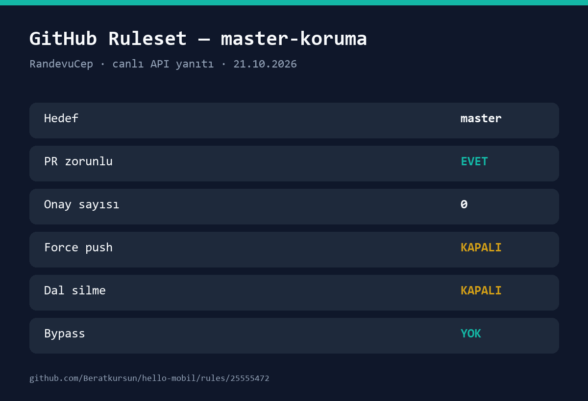

# PR ve Master Güvenliği

`master` dalı GitHub **ruleset** ile korunuyor: doğrudan push kapalı, her değişiklik PR ile ilerliyor, force push ve dal silme engelli. Bu belge kuralın kapsamını ve canlı API kanıtını kaydeder.

## 1. Ruleset

| Alan | Değer |
|---|---|
| Ad | `master-koruma` |
| ID | `25555472` |
| Hedef | Varsayılan dal (`master`) |
| Durum | `active` |
| PR zorunlu | Evet |
| Onay sayısı | 0 (PR açılması zorunlu, ek onay şartı yok) |
| Force push | Kapalı |
| Dal silme | Kapalı |
| Bypass | Yok (`current_user_can_bypass: never`) |

GitHub sayfası: <https://github.com/Beratkursun/hello-mobil/rules/25555472>

## 2. Oluşturma

```bash
gh api -X POST repos/Beratkursun/hello-mobil/rulesets --input ruleset.json
```

Kullanılan `ruleset.json`:

```json
{
  "name": "master-koruma",
  "target": "branch",
  "enforcement": "active",
  "conditions": {
    "ref_name": {
      "include": ["~DEFAULT_BRANCH"],
      "exclude": []
    }
  },
  "rules": [
    { "type": "deletion" },
    { "type": "non_fast_forward" },
    {
      "type": "pull_request",
      "parameters": {
        "required_approving_review_count": 0,
        "dismiss_stale_reviews_on_push": true,
        "require_code_owner_review": false,
        "require_last_push_approval": false,
        "required_review_thread_resolution": false
      }
    }
  ],
  "bypass_actors": []
}
```

## 3. Canlı Kanıt

`gh api repos/Beratkursun/hello-mobil/rulesets/25555472` yanıtı (özet):

```json
{
  "id": 25555472,
  "name": "master-koruma",
  "target": "branch",
  "enforcement": "active",
  "conditions": {
    "ref_name": { "include": ["~DEFAULT_BRANCH"], "exclude": [] }
  },
  "rules": [
    { "type": "deletion" },
    { "type": "non_fast_forward" },
    { "type": "pull_request", "parameters": { "required_approving_review_count": 0 } }
  ],
  "bypass_actors": [],
  "current_user_can_bypass": "never"
}
```



## 4. PR Akışı

1. `git checkout master && git pull origin master`
2. `git checkout -b feature/<kisa-ad>`
3. Geliştir; `bun run check`, `bun run test`, `bun run build`, `cargo test` çalıştır.
4. `git push -u origin feature/<kisa-ad>`
5. `gh pr create --fill --base master`
6. `gh pr diff` ile dosyaları kontrol et.
7. `gh pr merge <no> --merge`

## 5. Not

Ekran görüntüsü, GitHub ruleset API'sinin canlı yanıtından üretilmiş özet kanıttır; GitHub ayarlar sayfasının birebir görüntüsü değildir. Kural seti API üzerinden doğrulanmıştır.
